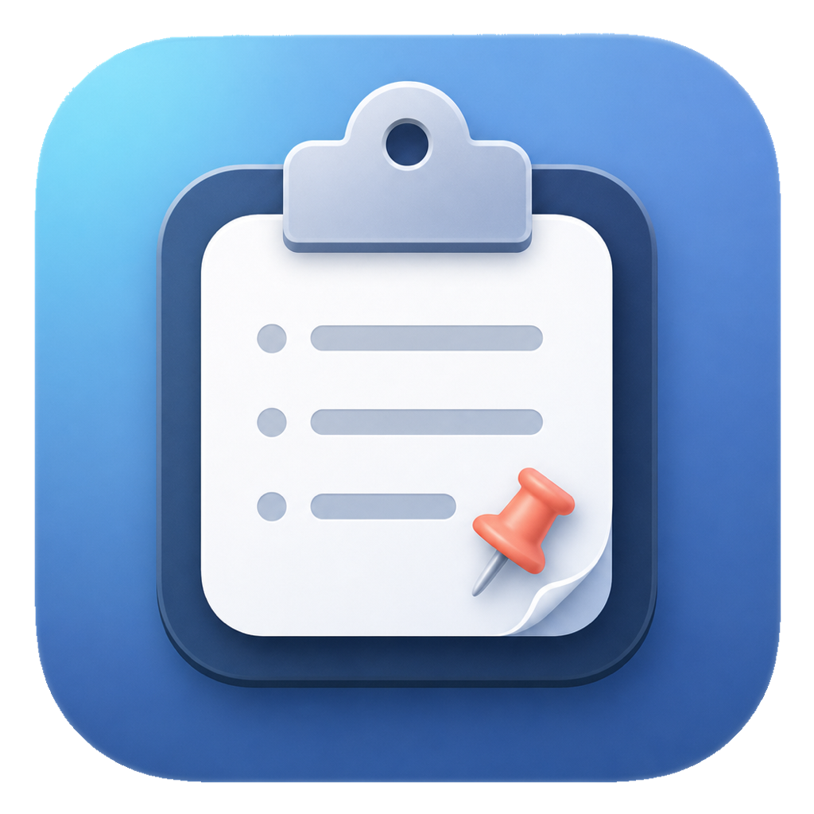

# ClipLeaf

<div align="center">



**Lightweight Modern Clipboard Manager**

[](https://opensource.org/licenses/MIT)
[](https://github.com/RustyPiano/ClipLeaf/releases/latest)
[](https://github.com/RustyPiano/ClipLeaf)

[Download](#installation) · [Features](#features) · [Development](#development)

[中文文档](README.md)

</div>

## Introduction

ClipLeaf (formerly ClipMan) is a desktop clipboard manager built with Rust and Svelte 5. History is stored in a local SQLite database.

## Features

### Core Features

- **Favorites & Snippets** - Star frequently used snippets, commands, or links, create custom favorites directly, reorder them, and edit text inline in the preview pane
- **Persistent Storage** - SQLite database, survives restarts, smart deduplication
- **Full-Text Search & Filters** - Search your history with matching terms highlighted. Switch to Text, Images, Files, or Links to run the same search within that category
- **Rich Inspector Preview** - Store plain text, HTML, images, and file lists; preview images clearly, copy HEX/RGB/HSL color values, open links, and reveal files in Finder/Explorer; macOS shows source app icons
- **QuickBar Access** - Open or toggle closed from any app (default `Cmd/Ctrl+Shift+V`), with native CJK IME support, keyboard selection, and auto-paste or copy-only modes
- **Paste Format** - Keep original formatting, strip it only when taking clips through ClipLeaf, or turn copied rich text into plain text right away; `⌥Enter` flips it for one paste
- **Mouse and Keyboard** - Copy, favorite, label, or delete directly from each row; select a range with `⇧↑/↓` or `⇧`-click, toggle rows with `⌘`-click for batch favorite, batch delete, or Enter to merge paste
- **Tray Menu** - Quick access to open QuickBar or copy recent and favorite items
- **Multiple Themes** - Light/Dark/Pink themes, follow system
- **Multi-Language** - English and Chinese support, auto-detect system language

### Additional Features

- Filter out private keys and common API tokens. On macOS and Windows, ClipLeaf skips items marked as confidential by default. With this filter enabled, Windows also skips items whose privacy markers it cannot read
- Auto-update
- Launch at startup
- Custom storage location
- Data management

## Installation

Choose an installer on the [website](https://clipleaf.app) or visit [GitHub Releases](https://github.com/RustyPiano/ClipLeaf/releases/latest) to download:

- **Windows**: `ClipLeaf_2.5.3_x64_en-US.msi`
- **macOS (Apple Silicon)**: `ClipLeaf_2.5.3_aarch64.dmg`
- **macOS (Intel)**: `ClipLeaf_2.5.3_x64.dmg`
- **Linux**: `ClipLeaf_2.5.3_amd64.AppImage`

When you upgrade from ClipMan, ClipLeaf migrates your history, favorites, and settings. If the database rename is interrupted, it resumes the next time you open the app.

### macOS Install & Permissions

**First launch**: builds are signed with a self-signed certificate but not Apple-notarized, so Gatekeeper may block the first launch (“cannot be opened because the developer cannot be verified”). To open it: right-click ClipLeaf in **Finder** → **Open**, or go to **System Settings** → **Privacy & Security** and click **Open Anyway** at the bottom. It launches normally afterwards.

**Accessibility permission**: auto-paste (simulating Cmd+V) requires Accessibility access. Grant it when prompted on first run, or add it manually:

**System Settings** → **Privacy & Security** → **Accessibility** → add and enable ClipLeaf

> If auto-paste stops working after an update, the permission was most likely lost. ClipLeaf will prompt you to re-grant it — just re-enable ClipLeaf in the list above (copying still works in the meantime; content is placed on the clipboard so you can paste manually).

## Usage

1. Use hotkey `Cmd+Shift+V` (macOS) / `Ctrl+Shift+V` (Windows) to open
2. Copy text, images, or files to see them in your history
3. Click the star icon to save favorites, or create new snippets directly in the Favorites panel
4. Use search bar to quickly find history records
5. Click an item to run the QuickBar default action: auto-paste by default, or copy only when auto-paste is disabled
6. Click tray icon for quick access (tray menu actions always copy only)

## Technology

**Backend**
- Tauri 2.11 - Lightweight desktop framework
- SQLite + FTS5 - High-performance database
- Rust - Memory-safe, high performance

**Frontend**
- Svelte 5 - Modern reactive framework
- Tailwind CSS 4 - Modern styling solution
- Vite 8 - Fast build tool

**Performance Positioning**
- Lightweight popup: QuickBar uses a small hidden window and opens on demand
- Local-first storage: SQLite persistence with no background network service
- Indexed search: FTS5 + trigram indexing reduces search latency

## Development

### Requirements

- Bun 1.3+
- Rust 1.96.0 (pinned by `rust-toolchain.toml`)
- System: Windows 10+ (WebView2 111+) / macOS 13.3+ / Linux (WebKitGTK 4.1 with modern CSS support)

### Quick Start

```bash
# Clone repository
git clone https://github.com/RustyPiano/ClipLeaf.git
cd ClipLeaf

# Install dependencies
bun install

# Development
bun tauri dev

# Build
bun tauri build
```

See [AGENTS.md](AGENTS.md) and [docs/adr/](docs/adr/) for development conventions and design decisions.

## Roadmap

- [ ] Smart image compression (AVIF/WebP/MozJPEG, configurable)
- [ ] Filter rules
- [ ] Plugin system
- [ ] CLI tool

## Contributing

Contributions are welcome through issues and pull requests.

- [Report Bug](https://github.com/RustyPiano/ClipLeaf/issues)
- [Feature Request](https://github.com/RustyPiano/ClipLeaf/issues)
- [Discussions](https://github.com/RustyPiano/ClipLeaf/discussions)

## License

[MIT License](LICENSE)

## Acknowledgments

- [Tauri](https://tauri.app/) - Desktop application framework
- [Svelte](https://svelte.dev/) - Frontend framework
- [rusqlite](https://github.com/rusqlite/rusqlite) - SQLite bindings
- [arboard](https://github.com/1Password/arboard) - Clipboard library

---

<div align="center">

**If you find it helpful, give it a Star!**

Made by [RustyPiano](https://github.com/RustyPiano)

</div>
